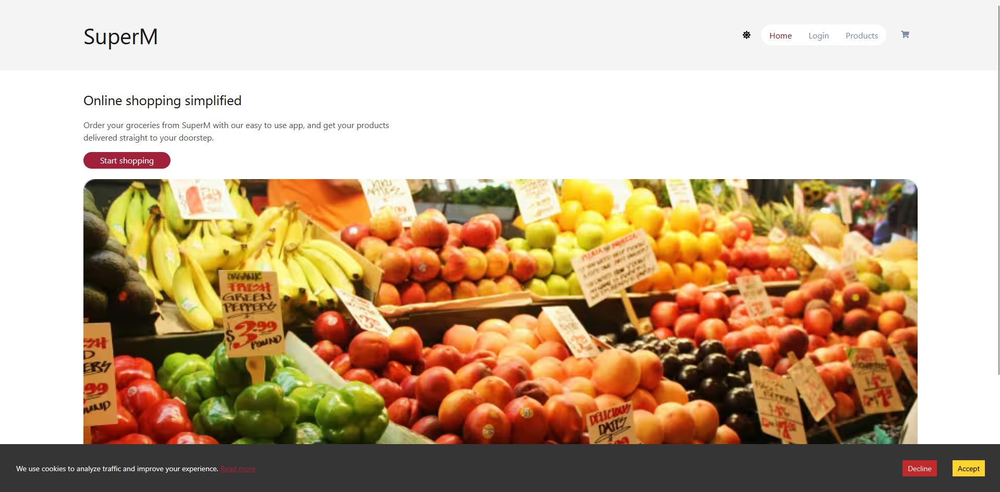
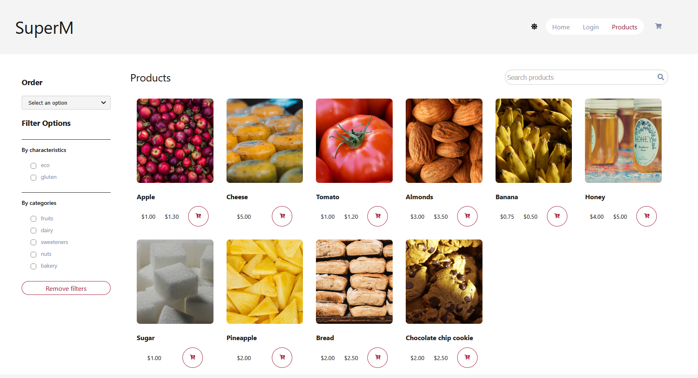
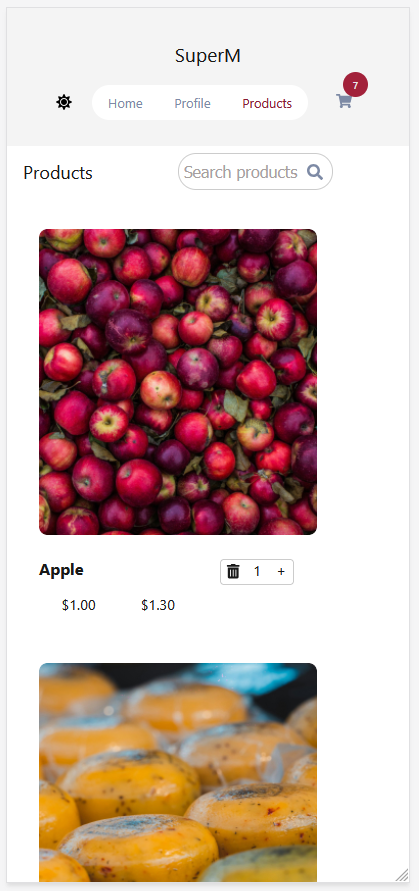
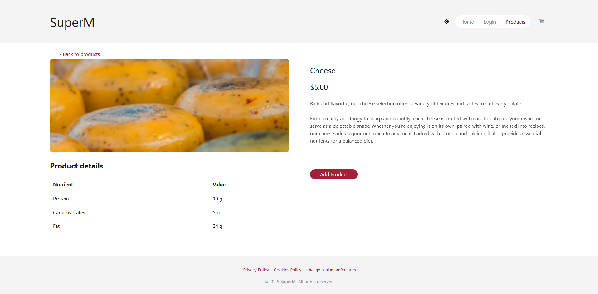
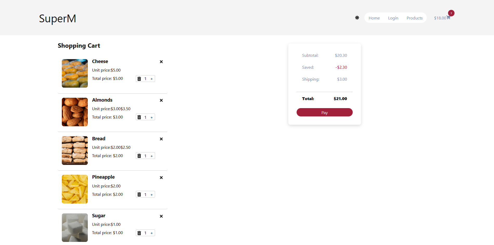
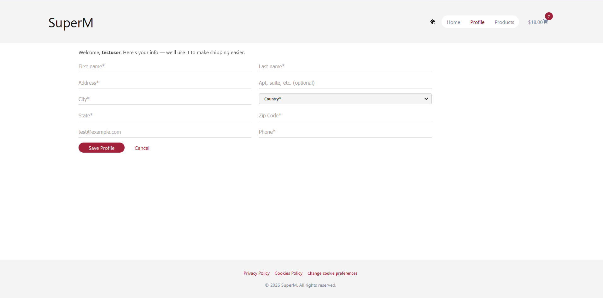

# SuperM

SuperM is an online supermarket built with React as a personal learning project. It lets users browse products, filter and search the catalog, view nutritional details, and complete a simulated purchase with the cart persisted locally.

[Leer en español](./README.md)

> The documentation and application interface are both in English.

## Demo

https://superm-hazel.vercel.app

**Demo sign-in:** enter `test@example.com` and any password with at least 4 characters, as required by the frontend form. The hosted RPC implementation is not in this repository, so its server-side password verification cannot be independently confirmed.

## Screenshots

| Landing | Products |
|---|---|
|  |  |

| Mobile | Product details |
|---|---|
|  |  |

| Cart and checkout | Profile |
|---|---|
|  |  |

## Features

- Product catalog loaded from Supabase/PostgREST
- Search, category filters, characteristics, and sorting
- Product detail page with price, description, and nutritional information
- Cart with quantities persisted in `localStorage`
- Sign-in through a Supabase RPC
- Editable profile with data persisted locally
- Multi-step checkout and simulated payment
- Success/error states, toasts, cookie consent, and responsive navigation
- Optional Google Analytics, loaded only after cookie consent

## Stack

- React 19 and React Router 7
- Vite 5
- Supabase / PostgREST
- TanStack Query
- Context API and `localStorage`
- Global CSS organized by page and responsive theme
- React Icons and React Toastify
- Google Analytics
- ESLint

## Architecture decisions

**Context API for client state:** the cart, filters, and notifications are shared UI state with a session-level lifetime. Context avoids introducing Redux or Zustand for these cases. The cart lives only in the browser and is persisted in `localStorage`.

**TanStack Query for remote state:** catalog and detail queries manage caching, retries, and loading/error states without duplicating that logic in components. Queries use a 5-minute `staleTime`.

**Data access layer:** `src/services/fetcher.js` centralizes Supabase calls. Components use `get()` or `callApi()`, so replacing the data source or adding a real API would not require changing the logic of every view.

**Lazy loading:** pages are loaded with `React.lazy`, so view-specific JavaScript is not requested until it is needed. The trade-off is a first-navigation loading delay. Lighthouse metrics and the actual bundle impact have not been measured yet.

**Styles:** I chose global CSS with kebab-case classes, organized by view under `src/styles/`, to keep the setup simple and share variables and components without extra tooling. The trade-off is that naming relies on manual discipline and the code has a risk of selector collisions. It does not use CSS Modules or a formal BEM methodology.

**Supabase separation:** the course-provided `users` project is read-only, so I cannot modify it. The course catalog also lacked the columns required by my filters, so I created my own `products` project rather than changing the course data. I took on the cost of managing both projects—two URLs, two anon keys, and two external resources—to support the catalog filters while retaining the course project's login RPC.

## Project structure

```text
src/
├── components/     Reusable UI components
├── context/        Shared client state
├── hooks/          Validation and reusable logic
├── pages/          Route-associated views
├── services/       Supabase data access adapter
├── styles/         Global page and theme styles
└── utils/          Filters and validation rules
```

## Data and API

The project uses two Supabase projects:

- `products`: product catalog and details
- `users`: sign-in through the `rpc/login` function

Data is queried through PostgREST under `/rest/v1/`:

- `GET /rest/v1/products`
- `GET /rest/v1/products?id=eq.<id>`
- `POST /rest/v1/rpc/login`

There are no custom REST endpoints such as `/auth/login` or `/orders`; checkout simulation runs in the frontend.

The frontend sends the email and password to `rpc/login`; it does not save either the password or a password hash to `localStorage`. Password hashing and verification happen outside the frontend and cannot be verified from this repository.

## Environment variables

To run the app with Supabase of your own, copy `.env.example` to `.env` and replace the four Supabase variables with your project values. You must create the catalog tables and data, implement the `login` RPC, and configure RLS policies yourself.

| Variable | Purpose |
|---|---|
| `VITE_SUPABASE_PRODUCTS_URL` | Catalog project URL |
| `VITE_SUPABASE_PRODUCTS_ANON_KEY` | Catalog anon key |
| `VITE_SUPABASE_USERS_URL` | Users project URL |
| `VITE_SUPABASE_USERS_ANON_KEY` | Users anon key |
| `VITE_GA_MEASUREMENT_ID` | Google Analytics measurement ID; optional |

Vite exposes `VITE_*` variables to the client. Use only public anon keys and configure Supabase RLS.

Google Analytics is loaded only when the user accepts the consent banner through the `cookieConsent` cookie. Rejecting consent prevents the script and `gtag` from starting. `.env.example` uses `G-XXXXXXXXXX` as a placeholder; replace it with your measurement ID or leave the variable empty to disable analytics.

## Setup

The primary way to try the complete app is through the [published demo](https://superm-hazel.vercel.app). This repository does not include the backend, and its Supabase schema is not versioned. The local Vite server can start without environment variables, but product data and sign-in require your own Supabase projects and schema as described above.

Requirements: Node.js 20+ and npm.

```bash
git clone https://github.com/tavcoder/SuperM.git
cd SuperM
npm install
npm run dev
```

The application will be available at `http://localhost:5173`.

## Scripts

```text
npm run dev      Development server
npm run build    Production build
npm run preview  Preview the production build
npm run lint     Run ESLint
```

This repository does not currently include a test runner or a `test` script.

## Known limitations

- Real order submission is not implemented.
- Payment is random and simulated to exercise success and error states without using a real provider; it does not process cards or PayPal.
- User and profile state exist only in memory and `localStorage`, with no complete persistent session.
- The sign-in form's demo hint permits any password of 4+ characters, but the server-side RPC cannot be audited from this repository; this is not a production authentication design.
- There are no automated tests.
- Accessibility and performance analysis with Lighthouse is not yet documented.
- Supabase schema, seed data, and RLS policies are not versioned.

## Next steps

- Connect a real checkout and order flow
- Add session and profile persistence in Supabase
- Replace randomized payment with a real provider
- Add component and cart logic tests
- Create a CI pipeline with lint and build
- Version the Supabase schema, seed data, and `login` RPC definition
- Measure accessibility and performance with Lighthouse and document the results
- Evaluate consolidating the two Supabase projects if the course project becomes editable
- Create a short GIF showing search, product selection, cart, and checkout

## Conventions

- Functional components and PascalCase
- camelCase functions and variables
- Kebab-case CSS classes
- Conventional Commits
- No `prop-types`; type annotations are preferred if the project migrates to TypeScript

## License

The code is published as **All Rights Reserved** unless the author explicitly grants permission. Reuse, modification, or distribution is not permitted.
