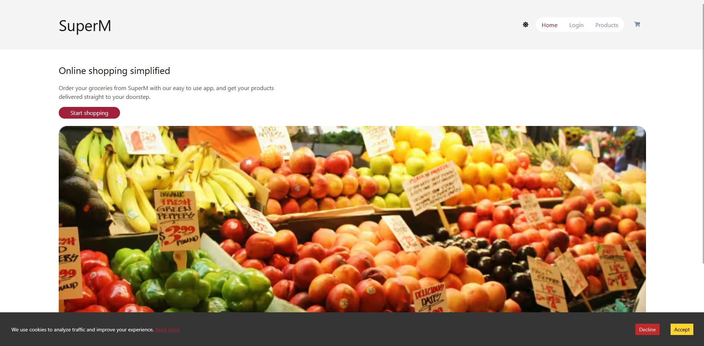
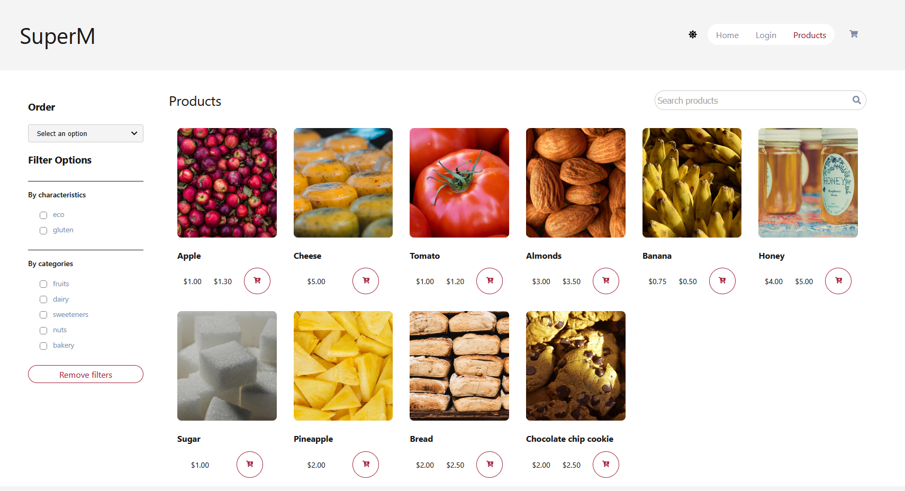
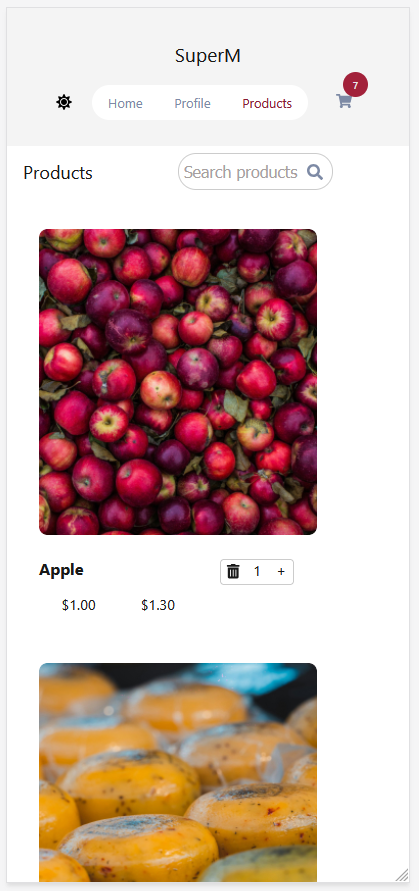
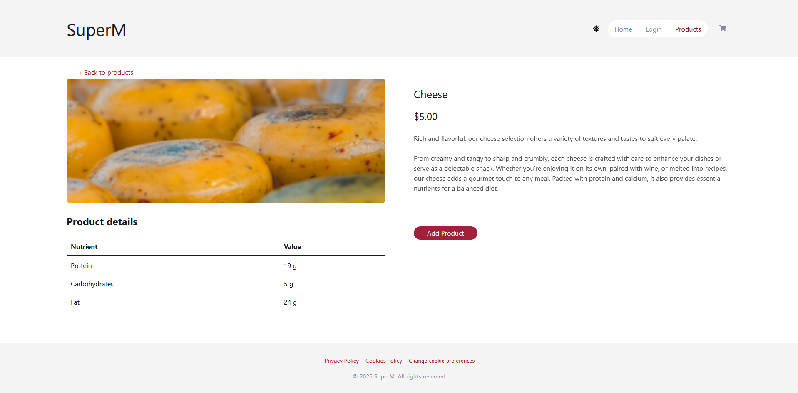
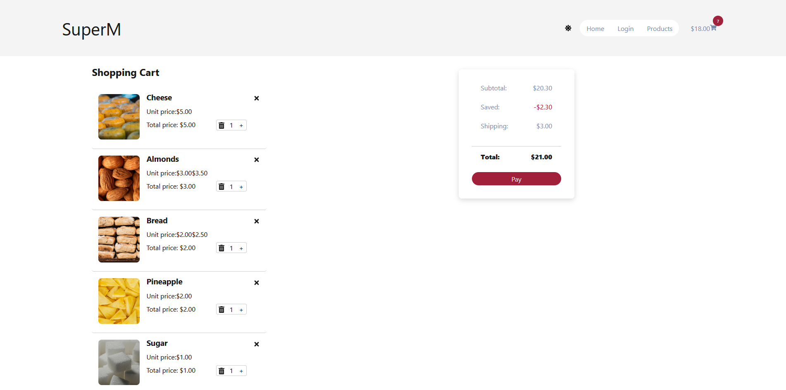
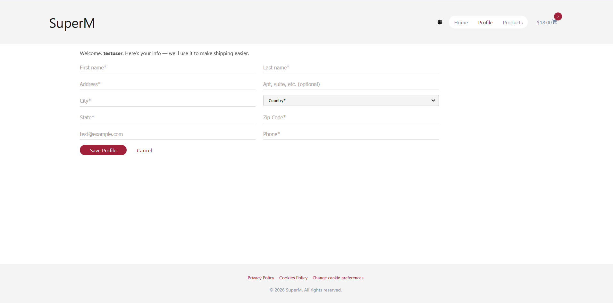

# SuperM

SuperM es una tienda de supermercado construida con React como proyecto personal de aprendizaje. Permite explorar productos, filtrar y buscar el catálogo, consultar detalles nutricionales y completar una compra simulada con el carrito persistido localmente.

[Read in English](./README.en.md)

> Esta documentación está en español y la interfaz de la aplicación está en inglés.

## Demo

https://superm-hazel.vercel.app

**Inicio de sesión de demo:** introduce `test@example.com` y cualquier contraseña de al menos 4 caracteres, como requiere el formulario del frontend. La implementación del RPC publicado no está en este repositorio, así que no se puede verificar de forma independiente su validación en el servidor.

## Capturas

| Landing | Products |
|---|---|
|  |  |

| Mobile | Product details |
|---|---|
|  |  |

| Cart and checkout | Profile |
|---|---|
|  |  |

## Features

- Catálogo cargado desde Supabase/PostgREST
- Busqueda, filtros por categoría, características y ordenamiento
- Página de detalle con precio, descripción e información nutricional
- Carrito con cantidades persistidas en `localStorage`
- Inicio de sesión mediante una RPC de Supabase
- Perfil editable con datos persistidos localmente
- Checkout de varios pasos y pago simulado
- Estados de éxito/error, toasts, consentimiento de cookies y navegación responsive
- Google Analytics opcional, cargado solo después del consentimiento de cookies

## Stack

- React 19 y React Router 7
- Vite 5
- Supabase / PostgREST
- TanStack Query
- Context API y `localStorage`
- CSS global organizado por página y tema responsive
- React Icons y React Toastify
- Google Analytics
- ESLint

## Decisiones de arquitectura

**Context API para estado cliente:** el carrito, los filtros y las notificaciones son estado compartido con una vida limitada a la sesión de interfaz. Context evita introducir Redux/Zustand para estos casos. El carrito vive solo en el navegador y se persiste en `localStorage`.

**TanStack Query para datos remotos:** las consultas del catálogo y los detalles gestionan caché, reintentos y estados de carga/error sin repetir esta lógica en los componentes. Las consultas tienen 5 minutos de `staleTime`.

**Capa de acceso a datos:** `src/services/fetcher.js` concentra las llamadas a Supabase. Los componentes usan `get()` o `callApi()`, por lo que cambiar la fuente o añadir una API real no requiere sustituir la lógica de cada vista.

**Carga diferida:** las páginas se cargan con `React.lazy`, por lo que el JavaScript de las vistas no se solicita hasta que se necesita. La contrapartida es una espera al navegar por primera vez a una vista. Todavía no se han medido las métricas de Lighthouse ni el impacto real en el bundle.

**Estilos:** elegí CSS global con clases kebab-case, organizadas por vista en `src/styles/`, para mantener una base sencilla y compartir variables y componentes sin configuración adicional. La contrapartida es que los nombres dependen de la disciplina manual y existe riesgo de colisiones. No usa CSS Modules ni una metodología formal BEM.

**Separación de Supabase:** el proyecto `users` proporcionado por el curso es de solo lectura, así que no puedo modificarlo. El catálogo del curso tampoco tenía las columnas que necesitaban mis filtros, por eso creé mi propio proyecto `products` en lugar de alterar los datos del curso. Asumí el coste de gestionar ambos proyectos —dos URLs, dos claves anon y dos recursos externos— para añadir los filtros y conservar el RPC de inicio de sesión del curso.

## Arquitectura del proyecto

```text
src/
├── components/     Componentes reutilizables
├── context/        Estado cliente compartido
├── hooks/          Validación y lógica reutilizable
├── pages/          Vistas asociadas a rutas
├── services/       Adaptador de acceso a Supabase
├── styles/         Estilos globales por página y tema
└── utils/          Filtros y validaciones
```

## Datos y API

El proyecto usa dos proyectos de Supabase:

- `products`: catálogo y detalle de productos
- `users`: inicio de sesión mediante la función RPC `rpc/login`

Los datos se consultan mediante PostgREST en `/rest/v1/`:

- `GET /rest/v1/products`
- `GET /rest/v1/products?id=eq.<id>`
- `POST /rest/v1/rpc/login`

No existe un servidor REST propio ni endpoints como `/auth/login` o `/orders`; la simulación de checkout se ejecuta en el frontend.

El frontend envía el email y la contraseña a `rpc/login`; no guarda en `localStorage` ni la contraseña ni un hash. El hashing y la verificación ocurren fuera del frontend y no pueden comprobarse desde este repositorio.

## Variables de entorno

Para ejecutar la app con Supabase propio, copia `.env.example` a `.env` y sustituye las cuatro variables de Supabase por los valores de tus proyectos. Tendrás que crear por tu cuenta las tablas y datos del catálogo, implementar el RPC `login` y configurar las políticas RLS.

| Variable | Uso |
|---|---|
| `VITE_SUPABASE_PRODUCTS_URL` | URL del proyecto del catálogo |
| `VITE_SUPABASE_PRODUCTS_ANON_KEY` | Clave anon del catálogo |
| `VITE_SUPABASE_USERS_URL` | URL del proyecto de usuarios |
| `VITE_SUPABASE_USERS_ANON_KEY` | Clave anon de usuarios |
| `VITE_GA_MEASUREMENT_ID` | ID de medición de Google Analytics; opcional |

Vite expone las variables `VITE_*` al cliente. Usa únicamente claves públicas y configura RLS en Supabase.

Google Analytics solo se carga cuando el usuario acepta el banner de consentimiento mediante la cookie `cookieConsent`. Si rechaza, no se inicia el script ni `gtag`. `.env.example` usa `G-XXXXXXXXXX` como valor de ejemplo; reemplázalo por tu ID de medición o deja la variable vacía para desactivar Analytics.

## Setup

La forma principal de probar la aplicación completa es mediante la [demo publicada](https://superm-hazel.vercel.app). Este repositorio no incluye el backend y su esquema de Supabase no está versionado. El servidor local de Vite puede iniciarse sin variables de entorno, pero los datos de productos y el inicio de sesión requieren proyectos y esquema propios, como se explica arriba.

Requisitos: Node.js 20+ y npm.

```bash
git clone https://github.com/tavcoder/SuperM.git
cd SuperM
npm install
npm run dev
```

La aplicación estará disponible en `http://localhost:5173`.

## Scripts

```text
npm run dev      Servidor de desarrollo
npm run build    Build de producción
npm run preview  Previsualizar el build
npm run lint     Ejecutar ESLint
```

Este repositorio no incluye actualmente un runner de tests ni un script `test`.

## Limitaciones conocidas

- La publicación real de pedidos no está implementada.
- El pago es aleatorio y simulado para permitir probar estados de éxito y error sin usar un proveedor real; no procesa tarjetas ni PayPal.
- El usuario y el perfil se mantienen solo en memoria/localStorage y no tienen una sesión persistida completa.
- La indicación de demo del formulario permite cualquier contraseña de 4 o más caracteres, pero el RPC del servidor no se puede auditar desde este repositorio; no es un diseño de autenticación para producción.
- No hay pruebas automatizadas.
- El análisis de accesibilidad y rendimiento con Lighthouse todavía no está documentado.
- El esquema de Supabase, los datos semilla y las políticas RLS no están versionados.

## Próximos pasos

- Conectar un flujo real de checkout y órdenes
- Añadir persistencia de sesión y perfil en Supabase
- Sustituir el pago aleatorio por un proveedor real
- Añadir pruebas de componentes y lógica de carrito
- Crear un pipeline de CI con lint y build
- Versionar el esquema de Supabase, los datos semilla y la definición del RPC `login`
- Medir accesibilidad y rendimiento con Lighthouse y documentar los resultados
- Evaluar unificar los proyectos de Supabase si el proyecto del curso permite modificaciones
- Crear un GIF corto del flujo completo de búsqueda, selección, carrito y checkout

## Convenciones

- Componentes funcionales y PascalCase
- Funciones y variables camelCase
- Clases CSS kebab-case
- Commits siguiendo Conventional Commits
- Sin `prop-types`; se prefieren anotaciones de tipos cuando el proyecto migre a TypeScript

## Licencia

El código se publica como **All Rights Reserved** salvo autorización expresa del autor. No se concede permiso para reutilizarlo, modificarlo o distribuirlo.
